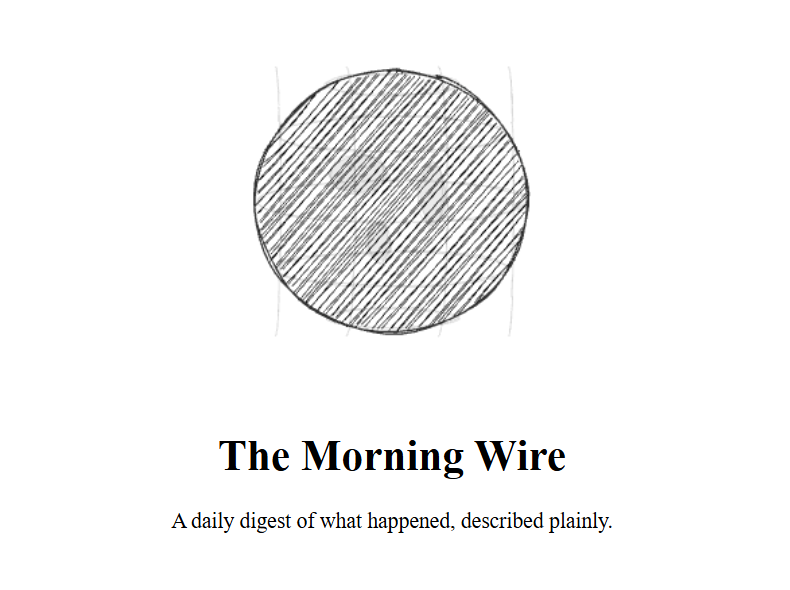
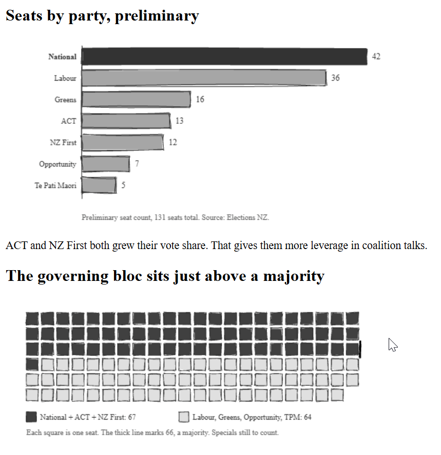
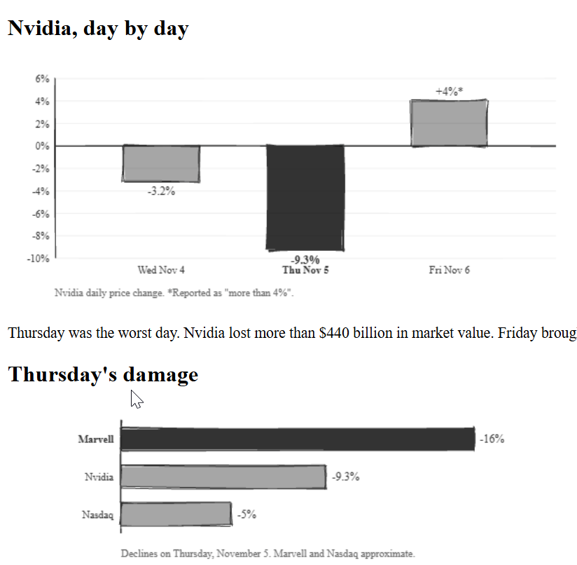

# The Morning Wire

A daily news digest generated by Claude. Raw HTML. No CSS. Default browser everything. Diagrams drawn with rough.js.

Live at [adis-lab.github.io/morning-digest](https://adis-lab.github.io/morning-digest/)

## What it looks like

<p>
  
  
  
</p>

Hand-drawn diagrams built with rough.js — timelines, bar charts, seat maps, and more. Raw HTML, no CSS, default browser everything.

## How it works

A batch script runs on Windows login via Task Scheduler. It calls a shell script that:

1. Checks the manifest for the last digest date.
2. Builds a list of any missed days between then and today.
3. For each missing day, runs two Claude CLI passes:
   - **Haiku** searches the web, writes the digest page, and updates the index and manifest.
   - **Sonnet** reads the digest and creates story pages, each with at least one rough.js diagram.
4. Opens today's digest in the browser.
5. Commits and pushes to GitHub. GitHub Pages serves it.

If the digest is already up to date, the script exits immediately.

## Running manually

```bash
bash scripts/generate-digest.sh
```

## Structure

```
digests/
    index.html                        # home page
    geography.html                    # interactive maps (India, US, Russia, Middle East)
    manifest.json                     # machine-readable index of all content
    2026-11/                          # monthly folder
        2026-11-08.html               # daily digest
        2026-11-08/                   # that day's story pages
            press-secretary.html
            nz-election.html
            ...
```

Each month gets a folder. Each day's story pages go in a subfolder named after the date.

## Manifest

`digests/manifest.json` indexes every digest, every story, and tags them. A bot reads this one file to understand everything without scanning HTML. Tags enable cross-referencing across dates.

## Geography

Interactive maps for learning regions. Click a state or country to see its name, capital, and language. Built with D3.js and TopoJSON. Currently covers India, the United States, Russia, and the Middle East.

## Guidelines

- `guidelines/digest-guidelines.md` — editorial rules, page structure, linking
- `guidelines/diagram-guidelines.md` — rough.js chart types, style rules, canvas sizing
- `guidelines/geography-guidelines.md` — how to add new maps, data sources, projections

## Scripts

- `scripts/generate-digest.bat` — entry point for Task Scheduler, logs to `scripts/digest-log.txt`
- `scripts/generate-digest.sh` — main generation logic, catches up on missed days
